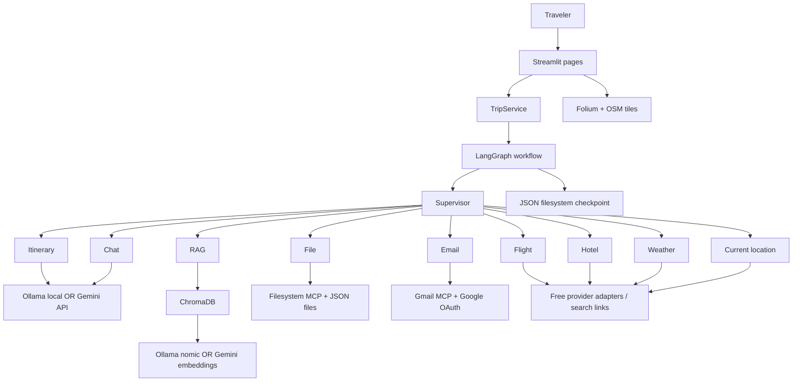

# AI Travel Planner

A Python and Streamlit travel planner. On a laptop it uses local Ollama models; an optional Google Gemini API mode is available for hosted Streamlit deployments. It combines LangGraph specialist agents, ChromaDB retrieval over uploaded documents, filesystem JSON persistence, optional Gmail OAuth, and source-backed public travel data. It does not use SQL, paid travel APIs, billing-enabled travel providers, or scraped booking websites. Gemini mode sends prompts and document text to Google's API and is not local-only.

## Architecture



## Technology stack

- Python 3.11 or newer, Streamlit and Streamlit-Folium
- LangChain and LangGraph for model access and supervisor-driven workflow
- Local mode: Ollama `llama3.2:1b` (generation) and `nomic-embed-text` (embeddings)
- Optional hosted mode: `langchain-google-genai` with Gemini chat and embedding models
- ChromaDB for persistent vector search
- Official Python MCP SDK for isolated filesystem and Gmail servers
- JSON, local files, and a filesystem LangGraph checkpointer; no relational database
- Folium with OpenStreetMap attribution

## Agent responsibilities

| Agent | Responsibility |
|---|---|
| Supervisor | Selects eligible agents; explicit form actions route without an extra model call |
| Flight | Generates route/date flight search links; no fabricated fares or live inventory |
| Hotel | Finds mapped accommodation records where public data is available; no prices or availability |
| Weather | Retrieves available Open-Meteo forecast data |
| Current Location | Uses browser coordinates only after user permission |
| Itinerary | Drafts an editable date-wise plan with the configured Ollama or Gemini model |
| RAG | Retrieves relevant uploaded travel-document excerpts from ChromaDB |
| File | Manages travel documents through filesystem MCP and trip records through JSON persistence |
| Email | Reads permitted Gmail data, creates drafts, and sends only after explicit confirmation |

## LangGraph workflow

The typed shared state carries the current request, conversation messages, results, statuses, itinerary, notices, and errors. The supervisor filters requested agents by required fields and permissions. Independent research agents fan out in parallel; itinerary generation follows research, then selected file/email operations run. Agent failures become readable state errors so one unavailable provider does not stop the complete graph. A JSON filesystem checkpointer persists thread conversation/checkpoint state under `data/checkpoints/`.

## RAG workflow

Upload PDF, DOCX, TXT, CSV, or Markdown in **Documents & RAG**. The File Agent validates and extracts text, splits it into source-tagged chunks, embeds using the configured provider, and persists vectors in Chroma. Ollama mode embeds locally with `nomic-embed-text`; Gemini mode sends document chunks and queries to the Google API. A question retrieves up to three relevant chunks by default, bounds the prompt context, and asks the configured model to answer from those sources. Gemini mode uses a separate Chroma directory so its vector dimensions do not mix with local Ollama vectors.

## MCP integration

Two separate local stdio servers use the official Python MCP SDK:

- `mcp_servers.filesystem_server`: restricted document file operations.
- `mcp_servers.gmail_server`: Gmail OAuth, relevant-message reads, draft creation, and guarded send.

The app launches servers through its MCP client. Gmail uses a Google Desktop OAuth client file at `secrets/google_oauth_client.json` (or `GMAIL_OAUTH_CLIENT_FILE`). Tokens are stored through the local OS credential store; never put credentials into source, trip JSON, or `.env.example`. Gmail sending requires an explicit confirmation in the UI and an agent-side confirmation flag.

## Free API integrations and restrictions

| Service | Use | Conditions and fallback |
|---|---|---|
| Open-Meteo | Weather forecast | No key for eligible non-commercial use; attribution required; cached and locally capped; reports unavailable forecast ranges |
| OpenStreetMap Nominatim | User-triggered geocoding | No key; identifying User-Agent, attribution, caching, max 1 request/second; no bulk lookup or autocomplete |
| Overpass API | Public accommodation records | No key; shared public endpoint, modest user-triggered query volume, rate-limited and cached; records are incomplete and do not imply availability |
| OpenTripMap | Optional attractions | Requires configurable API key and free-plan confirmation; non-commercial use and quota restrictions apply; otherwise a map-search link is shown |
| OSM tiles / Folium | Interactive map | Attribution displayed; no bulk tile download or prefetch; community service is best-effort |
| OSRM public demo | Optional light route estimates | No key; light use only, locally rate-limited; no SLA |
| Google Flights / Hotels links | Search links | Links only; no scraping, prices, or availability claims |
| Gmail API | User-authorized email | Official OAuth and applicable quotas; no Gmail password or paid email provider; sending requires confirmation |

Free public endpoints can change terms, quotas, or availability. These adapters are for eligible personal/non-commercial use. Review each provider’s current policy before increasing request volume or changing deployment purpose. No provider is configured to use paid production access. Amadeus flight offers are intentionally not integrated because test data is not reliable live inventory and production may require billing.

## Install Ollama and models

1. Install Ollama for Windows from [ollama.com/download](https://ollama.com/download).
2. Start Ollama (the local API should be at `http://localhost:11434`).
3. In PowerShell, download the models:

```powershell
ollama pull llama3.2:1b
ollama pull nomic-embed-text
ollama list
```

This is the default laptop mode. It validates that Ollama's base URL is localhost/loopback and sends no LLM or embedding requests to a cloud provider.

## Python environment setup on Windows

Open PowerShell in the project folder. Python 3.11 or newer is recommended. Create a virtual environment, activate it, and install packages:

```powershell
py -3.11 -m venv .venv
.\.venv\Scripts\Activate.ps1
python -m pip install --upgrade pip
python -m pip install -r requirements.txt
Copy-Item .env.example .env
```

If PowerShell blocks activation, use `Set-ExecutionPolicy -Scope CurrentUser RemoteSigned` or invoke the environment interpreter directly with `.\.venv\Scripts\python.exe -m pip install -r requirements.txt`.

## Gmail OAuth setup

1. In Google Cloud Console, create/select a project and enable the Gmail API. Do not enable billing for this app.
2. Configure the OAuth consent screen and create an OAuth Client ID for a **Desktop app**.
3. Download its client JSON to `secrets/google_oauth_client.json`; the `secrets/` directory is ignored by Git.
4. Run the app and select **Connect Gmail with Google OAuth**. Complete Google’s consent flow in the browser.
5. Use email reading/drafting only after authorization. Sending requires checking the explicit send-confirmation box.

OAuth availability depends on Google account, consent-screen mode, and applicable quotas. Gmail is optional; the rest of the app works without Gmail credentials.

## Run the Streamlit app

Ensure Ollama is running and both models are downloaded, then:

```powershell
streamlit run app.py
```

Streamlit prints a local URL, typically `http://localhost:8501`. Navigate using the sidebar. Use **Trip Planner** for a plan, **Documents & RAG** for uploads/questions, **Saved Trips** for JSON records, and **Gmail** for OAuth and itinerary drafts.

## Configuration

Copy `.env.example` to `.env`. Important local defaults include:

- `OLLAMA_BASE_URL`, model names, request timeout and generation limit
- `RAG_CHUNK_SIZE=650`, `RAG_CHUNK_OVERLAP=80`, `RAG_RETRIEVAL_K=3`
- `DATA_DIRECTORY`, `CHROMA_PERSIST_DIRECTORY`, `CHECKPOINT_DIRECTORY`
- Optional `OPENTRIPMAP_API_KEY` and `OPENTRIPMAP_FREE_PLAN_CONFIRMED`
- Gmail OAuth file path and conservative public API request caps

Never add OAuth client files, tokens, or real API keys to source control.

## Deploy to Streamlit Community Cloud

The current code can start in Community Cloud only when it is configured for Gemini; the cloud container cannot reach Ollama running on your laptop at `localhost`. In Streamlit Community Cloud, open the app's **Settings → Secrets** and add TOML like this:

```toml
AI_PROVIDER = "gemini"
GOOGLE_API_KEY = "your-Google-AI-Studio-key"
GEMINI_CHAT_MODEL = "gemini-3.1-flash-lite"
GEMINI_EMBEDDING_MODEL = "gemini-embedding-2"
```

Then restart/reboot the app. Do not enable Google billing if you want to remain on free-tier access. Free-tier model availability and quotas can change; inspect Google AI Studio usage. Google states that content submitted on its free tier may be used to improve its products, so do not upload private travel documents in Gemini mode unless you accept that provider handling. See [Gemini pricing and free-tier terms](https://ai.google.dev/gemini-api/docs/pricing).

Streamlit Community Cloud does not guarantee persistence for files written by a running app. Saved trips, uploaded documents, Chroma vectors, API caches, and graph checkpoints may be lost on restart/redeploy. Gmail OAuth uses a local Desktop OAuth/keyring flow and may not work as-is in a hosted container. Use the cloud deployment as a demo unless you add a suitable persistent storage and hosted OAuth design.

The app reads `AI_PROVIDER` and `GOOGLE_API_KEY` from Streamlit secrets. Locally, leave `AI_PROVIDER=ollama` in `.env` to keep the original local-model workflow.

## Troubleshooting

- **`streamlit` or package import missing:** activate `.venv` and run `python -m pip install -r requirements.txt` with network access.
- **Ollama connection refused:** start Ollama, verify `ollama list`, then check `OLLAMA_BASE_URL`.
- **`[Errno 99] Cannot assign requested address` in Streamlit Cloud:** the deployed app is trying to connect to laptop-only Ollama. Set `AI_PROVIDER = "gemini"` and `GOOGLE_API_KEY = "..."` in Streamlit App settings → Secrets, then reboot.
- **Gemini API key missing:** verify the exact `GOOGLE_API_KEY` secret name, save settings, then reboot the app.
- **Model not found:** run `ollama pull llama3.2:1b` and `ollama pull nomic-embed-text`.
- **Slow generation:** close other model-heavy apps, use concise requests, reduce `OLLAMA_NUM_PREDICT`, and allow the first request to load model weights.
- **Document indexing fails:** ensure Ollama and `nomic-embed-text` are available; confirm format is supported and file is not encrypted/corrupt.
- **No places/weather data:** use the displayed fallback/search link; public endpoints can rate-limit or be temporarily unavailable.
- **Gmail OAuth fails:** check Desktop OAuth client JSON path, Gmail API enablement, consent status, and local browser authorization.
- **Map is blank:** map tiles need internet access and are subject to the OpenStreetMap tile policy; the itinerary/results remain available.

## Known limitations

- `llama3.2:1b` is small: complex routing, long itineraries, and nuanced document answers may be less reliable than larger models. The app limits output/context size and labels suggestions; review the draft.
- Flight and hotel booking inventory, prices, and availability are not fetched. Flights and hotel offers use search links; mapped hotel records are incomplete.
- Weather forecasts are available only within the provider forecast horizon; forecasts are not long-range climate predictions.
- Public geocoding, map tiles, Overpass, OSRM, and Open-Meteo have policies, quotas, and no guaranteed availability. Non-commercial restrictions apply to relevant free tiers.
- Gmail, OpenTripMap, external data, and browser location are optional and may require permission or credentials.
- Streamlit session state is temporary UI state. Local JSON trips/preferences, documents, Chroma vectors, and graph checkpoints persist on the laptop; Community Cloud filesystem writes are not guaranteed to persist.
- Gemini is an optional cloud API provider. Keep it disabled locally for private, local-only inference.

## Project layout

```text
agents/       Supervisor and specialist agents
config/       Environment-backed settings
data/         Local JSON, checkpoints, vectors, cache and documents (gitignored)
graph/        Typed LangGraph state, workflow and JSON checkpoint saver
mcp_servers/  Separate filesystem and Gmail MCP servers plus travel/location tools
rag/          Loading, chunking, embeddings, Chroma and retrieval QA
services/     Ollama, trip, persistence, MCP, map and provider adapters
tests/        Workflow tests
tools/        Agent-facing tool interfaces
ui/           Modular Streamlit pages and components
app.py        Streamlit entry point
```
